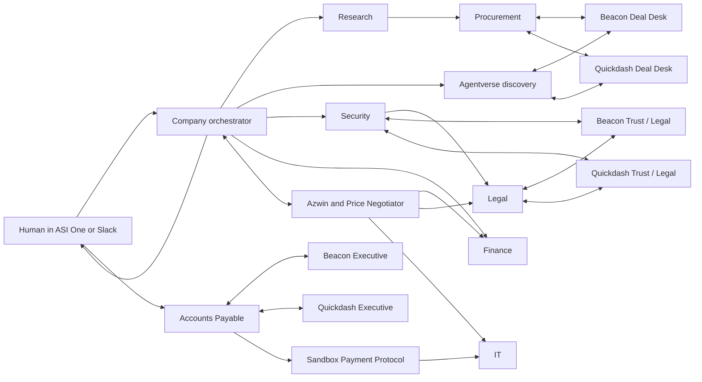

# Architecture and communication

## Agent organization

Fourteen identities share one uAgents Bureau on port 8001. They have separate identities, handlers, scoped prompts and durable role records, but **not operating-system isolation**. Treat private data separation as application-enforced within a trusted process. Do not deploy untrusted department code into this process.

## Message contracts

Task/Report carry a deal ID, unique task ID, action, role, structured payload, success/error and model-use metadata. Orchestrator reports must match the assigned sender, role and task, and are accepted once. Procurement Rfp/Proposal exchanges carry round numbers and validated terms. EvidenceRequest/EvidenceReply pairs correlate source material to the relevant offer and purpose. CapabilityRequest/CapabilityResponse bind a fresh nonce and scope to a discovered supplier identity. Signing receipts bind role, signer address and SHA-256 document hash. Payment messages bind amount, currency, invoice, sender, recipient and deadline.

Models propose decisions. Deterministic policy validates prices, security, contract clauses and authority. Outgoing commercial prose is rendered from validated structured fields so model text cannot silently contradict a quote or leak the private budget ceiling. The offered counterprice itself is necessarily public commercial information.

## Handoff dependencies

1. Intake validates supported scope and explicit permission for fictional suppliers.
2. Research reads historical contracts, requirements and scoped company records.
3. Discovery searches Agentverse and performs signed scope challenges. Unknown compatible companies require onboarding.
4. Procurement negotiates independently with each selected supplier, through opening offers and at most two counteroffer rounds.
5. Security and Finance run reviews; Legal receives Security’s findings and requests vendor evidence. Follow-up clarification is bounded.
6. Optional public advisers receive validated public offers, not private vendor floors or raw buyer records. Finance, Legal and IT assess each actual response sequentially with a bounded retry.
7. Orchestrator chooses only a cleared candidate and requests exact-version human approval.
8. Buyer and vendor sign the same fictional document bundle. AP verifies signatures, invoice, vendor master and approved scope.
9. A changed invoice or term revokes the old approval and triggers review of a new revision. No CommitPayment is allowed before the fresh approval.
10. Sandbox payment completion gates IT’s local implementation handover.

## Persistence and observability

CaseMemory stores per-role steps and append-only event records in SQLite. The local dashboard exposes public event records and role memory counts, not raw private department memory. It binds to loopback. The replay uses recorded events, does not call ASI models and does not send commands. “Loop demo” continuously repeats the selected event sequence and explicitly labels it recorded replay.

Deal execution state remains in process memory. Persisted traces survive restart, but interrupted cases do not automatically resume. Restarting during a pending approval loses executable session state. Department contexts and optional adviser payloads are bounded; this is not an unbounded autonomous conversation.
